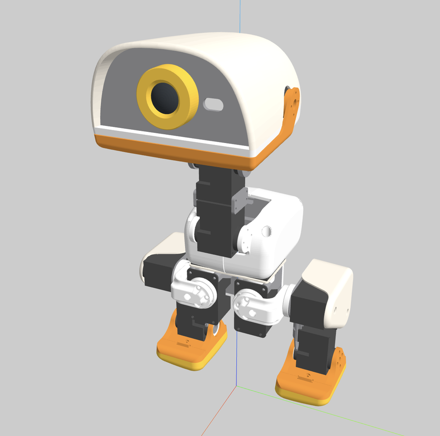

<div align="center">

# microduck_urdf

🇺🇸 **English** | 🇰🇷 [Korean](README.ko.md)

**ROS 2 URDF package for the Pollen Robotics Microduck biped**

Geometry, mass, inertia and joints carried over faithfully from the original MuJoCo model.

[](https://github.com/Indigochi1d/microduck_urdf/actions/workflows/ci.yml)
[](https://docs.ros.org/en/kilted/)
[](LICENSE)
[](meshes/LICENSE.md)



</div>

---

## Overview

[Microduck](https://github.com/pollen-robotics/microduck) is an open-source biped robot by Pollen Robotics, 25 cm tall and under 800 g.
This package takes the **MuJoCo model (MJCF)** from Pollen Robotics' reinforcement learning repository [microduck_rl](https://github.com/pollen-robotics/microduck_rl)
and converts it into a URDF that is ready to use in ROS 2.
Link names follow the `<driving joint>_link` convention (e.g. `left_knee` → `left_knee_link`), and the trunk is `base_link`.

## Features

| Item                | Description                                                                                                   |
| :------------------ | :------------------------------------------------------------------------------------------------------------ |
| Physical parameters | Per-link mass, center of mass and inertia tensor (737.2 g total), plus joint damping/friction, from the MJCF. |
| Collision geometry  | Includes the MJCF collision meshes; disable them with `collision:=false`.                                     |
| Sensor frames       | IMU, both feet, head camera, ToF, head IMU and beak tip as fixed frames.                                      |
| Ready-made launch   | `display.launch.py` brings up RViz2 and joint sliders in one command.                                         |

## Joints

| Group     | Joint             | Parent → Child                                 | Range (rad)    |
| :-------- | :---------------- | :--------------------------------------------- | :------------- |
| Left leg  | `left_hip_yaw`    | `base_link` → `left_hip_yaw_link`              | -0.436 ~ 0.524 |
|           | `left_hip_roll`   | `left_hip_yaw_link` → `left_hip_roll_link`     | -0.384 ~ 0.384 |
|           | `left_hip_pitch`  | `left_hip_roll_link` → `left_hip_pitch_link`   | -1.571 ~ 1.571 |
|           | `left_knee`       | `left_hip_pitch_link` → `left_knee_link`       | -1.571 ~ 1.571 |
|           | `left_ankle`      | `left_knee_link` → `left_ankle_link`           | -1.571 ~ 1.571 |
| Right leg | `right_hip_yaw`   | `base_link` → `right_hip_yaw_link`             | -0.524 ~ 0.436 |
|           | `right_hip_roll`  | `right_hip_yaw_link` → `right_hip_roll_link`   | -0.384 ~ 0.384 |
|           | `right_hip_pitch` | `right_hip_roll_link` → `right_hip_pitch_link` | -1.571 ~ 1.571 |
|           | `right_knee`      | `right_hip_pitch_link` → `right_knee_link`     | -1.571 ~ 1.571 |
|           | `right_ankle`     | `right_knee_link` → `right_ankle_link`         | -1.571 ~ 1.571 |
| Neck/head | `neck_pitch`      | `base_link` → `neck_pitch_link`                | -1.571 ~ 1.047 |
|           | `head_pitch`      | `neck_pitch_link` → `head_pitch_link`          | -1.571 ~ 1.571 |
|           | `head_yaw`        | `head_pitch_link` → `head_yaw_link`            | -2.967 ~ 2.967 |
|           | `head_roll`       | `head_yaw_link` → `head_roll_link`             | -0.436 ~ 0.436 |

Every joint uses the MJCF actuator `forcerange` as effort (0.96 Nm) and the XL330 no-load speed as velocity (10.8 rad/s).

**Sensor frames:** `imu_link`, `left_foot_link`, `right_foot_link`, `head_camera_link`, `tof_link`, `head_imu_link`, `mouth_tip_link`

## Package layout

```
microduck_urdf/
├── launch/
│   ├── description.launch.py   robot_state_publisher
│   └── display.launch.py       RViz2 + joint_state_publisher_gui
├── meshes/                     STL meshes (CC BY-NC-SA 4.0)
├── rviz/display.rviz
├── test/test_microduck_urdf.py
└── urdf/
    ├── microduck.urdf.xacro    entry point (collision argument)
    ├── microduck.xacro         link/joint macro
    └── microduck.urdf          standalone URDF
```

## Getting started

### Build

```bash
mkdir -p ~/ros2_ws/src && cd ~/ros2_ws/src
git clone https://github.com/Indigochi1d/microduck_urdf.git

cd ~/ros2_ws
rosdep install --from-paths src --ignore-src -y
colcon build --packages-select microduck_urdf
source install/setup.bash
```

### Run

```bash
# RViz2 with joint sliders
ros2 launch microduck_urdf display.launch.py

# Publish robot_description and TF only
ros2 launch microduck_urdf description.launch.py collision:=false
```

### Preview without ROS

`urdf/microduck.urdf` references its meshes through the relative path `../meshes/`, so it opens directly in any URDF viewer.
In VSCode, the **URDF Visualizer** extension is recommended.

## Tests

```bash
colcon test --packages-select microduck_urdf --event-handlers console_direct+
colcon test-result --verbose
```

Checks the joint set and limits, link tree connectivity, mass and inertia values, mesh files, xacro output and the `collision` option.

## Attribution and license

The robot model in this package originates from the MuJoCo model published by **Pollen Robotics**.

| Files                              | Source                                                                          | License                              |
| :--------------------------------- | :------------------------------------------------------------------------------ | :----------------------------------- |
| URDF, xacro, launch, tests         | This repository (converted from the original MJCF)                              | [Apache 2.0](LICENSE)                |
| `meshes/*.stl` (copied unmodified) | [pollen-robotics/microduck_rl](https://github.com/pollen-robotics/microduck_rl) | [CC BY-NC-SA 4.0](meshes/LICENSE.md) |

The meshes may be used **for non-commercial purposes only**, and adaptations must be shared under the same license.
Because the URDF references the meshes, redistributing it together with the meshes must follow these terms.

## References

- [pollen-robotics/microduck](https://github.com/pollen-robotics/microduck) — Microduck robot software
- [pollen-robotics/microduck_rl](https://github.com/pollen-robotics/microduck_rl) — original MuJoCo model and RL environments
- [onshape-to-robot](https://github.com/Rhoban/onshape-to-robot) — tool that generated the upstream MJCF
- [mjcf2urdf](https://github.com/iory/mjcf2urdf) — MJCF to URDF conversion tool
